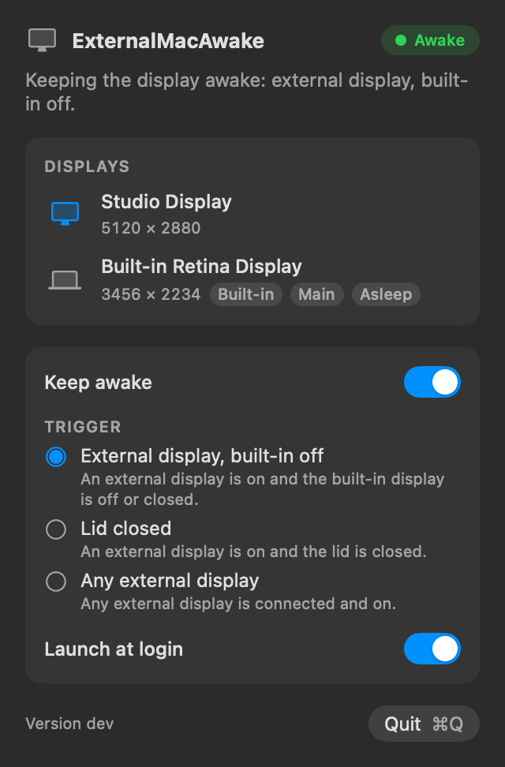
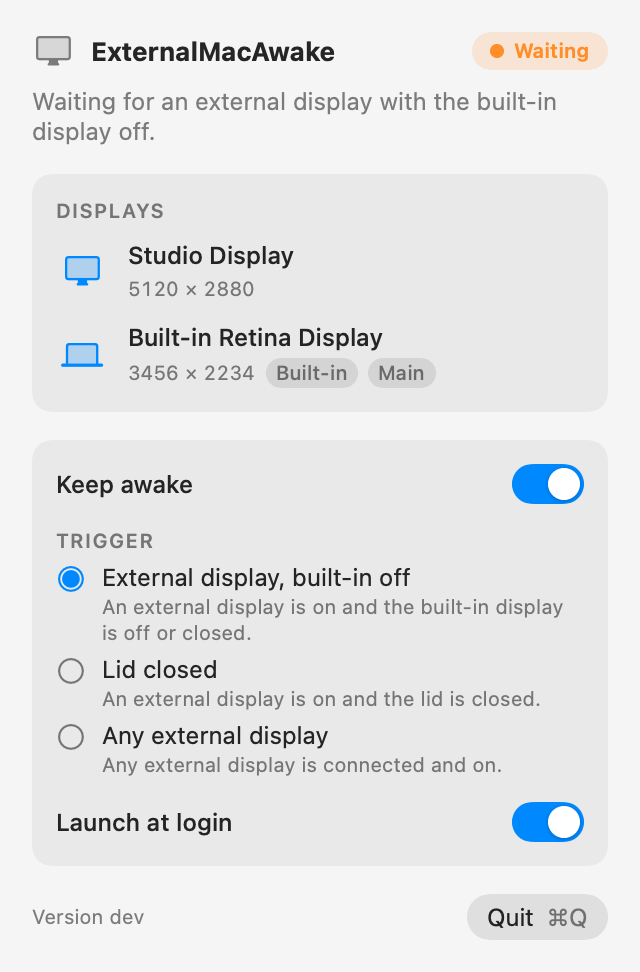

# ExternalMacAwake

[](https://github.com/ijat/ExternalMacAwake/actions/workflows/ci.yml)
[](LICENSE.md)

A small macOS menu-bar app that keeps your external display awake while the laptop's own screen is
off, for example when the lid is closed and the Mac is driving a monitor. Switch it off, or quit
it, and your Mac goes back to its normal sleep behaviour.

<p align="center">
  
  &nbsp;&nbsp;
  
</p>

## Why

With the built-in display off, macOS still dims and sleeps the external monitor after your
display-sleep timeout. Changing the system setting with `pmset` needs admin rights and has to be
reverted by hand. ExternalMacAwake does it without touching any system setting.

## Features

- Holds a display-sleep power assertion only while the selected trigger holds.
- Three triggers, switchable from the popover (see [Triggers](#triggers)).
- Popover with live state, a list of connected displays, light and dark appearance.
- Launch at login (on by default, you can turn it off).
- No Dock icon; it lives in the menu bar.
- No `pmset`, no `sudo`, nothing written to system settings.

## How it works

The app creates an IOKit power assertion of type `PreventUserIdleDisplaySleep`, named
`ExternalMacAwake: keeping external display awake`. The assertion belongs to the app's process:

- Turning "Keep awake" off, switching to a trigger that does not hold, or quitting releases it.
- If the app crashes or is killed, macOS drops the assertion with the process.

So there is nothing to restore afterwards. To see it while the app is running:

```sh
pmset -g assertions | grep ExternalMacAwake
```

The app watches display changes (plug, unplug, sleep, wake) and also re-checks every 5 seconds,
because the lid state has no change notification.

## Triggers

Pick one in the popover; the choice is remembered. An external display counts when it is online,
active and not asleep.

| Trigger | Keeps the display awake when | Default |
| --- | --- | --- |
| External display, built-in off | an external display counts and the built-in display is absent, inactive or asleep | yes |
| Lid closed | an external display counts and the lid is closed (`AppleClamshellState`) | |
| Any external display | an external display counts | |

If the lid state cannot be read (for example on a desktop Mac), "Lid closed" never holds.

## Install

Requires macOS 14 or later.

1. Download `ExternalMacAwake-<version>.zip` from the
   [Releases](https://github.com/ijat/ExternalMacAwake/releases) page and unzip it.
2. Move `ExternalMacAwake.app` to `/Applications`.
3. Open it. The app is ad-hoc signed, not signed with a Developer ID, and **not notarized**, so
   Gatekeeper blocks the first launch. Either right-click the app and choose **Open**, or remove
   the quarantine flag:

   ```sh
   xattr -dr com.apple.quarantine /Applications/ExternalMacAwake.app
   ```

The release also ships `SHA256SUMS.txt` to check the download. On first launch the app registers
itself as a login item; if macOS asks you to approve it, use System Settings > General > Login
Items. The bundle identifier is `my.ijat.ExternalMacAwake`.

## Build from source

Requires Xcode 26 or later (Swift 6.2+, which provides `swift format` and `isolated deinit`).

```sh
make build      # debug build
make test       # unit tests
make lint       # swift-format, strict
make bundle     # universal, ad-hoc signed build/ExternalMacAwake.app
make run        # bundle, then open the app
make install    # bundle, then copy to ~/Applications
make preview    # render the popover to PNGs in build/preview (offscreen)
make zip        # bundle, plus build/ExternalMacAwake-<version>.zip
make format     # format sources in place
make clean
```

## Architecture

```text
Sources/AwakeCore/          UI-free logic, unit tested
  Models/                   DisplayInfo, SystemSnapshot
  Triggers/                 TriggerRule, BuiltInRules, TriggerCatalog
  System/                   DisplayProvider, LidStateProvider, PowerAssertion (protocols + adapters)
  Settings/                 SettingsStore (UserDefaults)
  AwakeController.swift     decides, and holds or releases the assertion
Sources/ExternalMacAwake/   SwiftUI app: MenuBarExtra, views, login item, preview renderer
Tests/AwakeCoreTests/       tests with fake providers
Resources/Info.plist        bundle metadata (version comes from VERSION)
scripts/bundle.sh           builds the .app (and the zip)
```

`AwakeController` reads a `SystemSnapshot` (displays and lid state) from its providers, asks the
selected `TriggerRule` whether to keep awake, and acquires or releases the `PowerAssertion` so that
the assertion is held exactly when the app is enabled and the rule holds. All system access sits
behind protocols, so the tests run the controller with fakes.

### Adding a trigger

1. Add a struct conforming to `TriggerRule` in `Sources/AwakeCore/Triggers/BuiltInRules.swift`
   (a stable `id`, a `title`, a `summary`, a `waitingReason` and `shouldKeepAwake(_:)`). Rules are
   pure functions of a `SystemSnapshot`.
2. List it in `TriggerCatalog.standard`; the order there is the order in the popover.
3. Add rows for it to the table in `Tests/AwakeCoreTests/TriggerRuleTests.swift`.
4. If it needs a new input (say, power source), add the field to `SystemSnapshot`, read it in a
   provider protocol with an adapter, and fake it in the tests.
5. Add a line to the triggers table above and to `CHANGELOG.md`.

## Contributing

See [CONTRIBUTING.md](CONTRIBUTING.md).

## License

[MIT](LICENSE.md), Copyright (c) 2026 Ijat.
